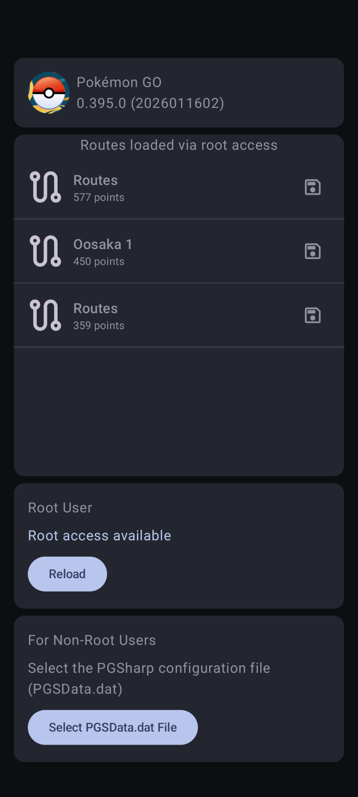

# PGSharp Route Exporter

PGSharp Route Exporter is an Android app that allows you to export your favorite routes from **PGSharp** as **GPX files**.

- **Rooted devices**: Routes are extracted automatically from PGSharp app data
- **Non-root devices**: Routes can be loaded manually from the `PGSData.dat` configuration file

This makes it easy to back up your routes or use them with other GPS and mapping applications.

## Preview

